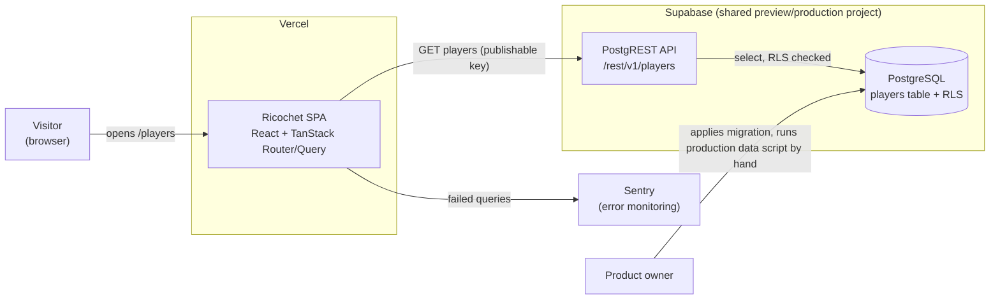
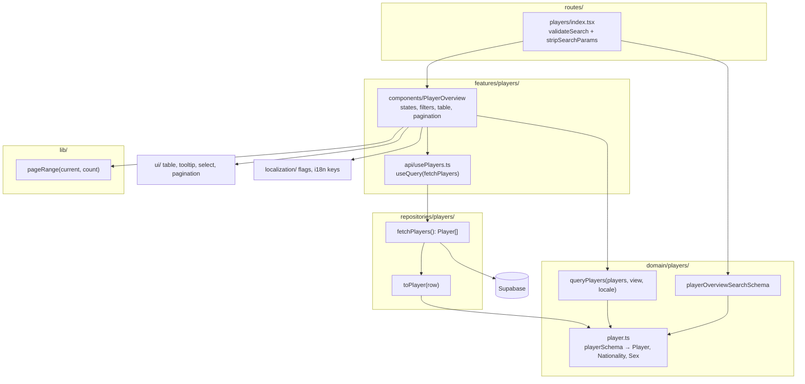
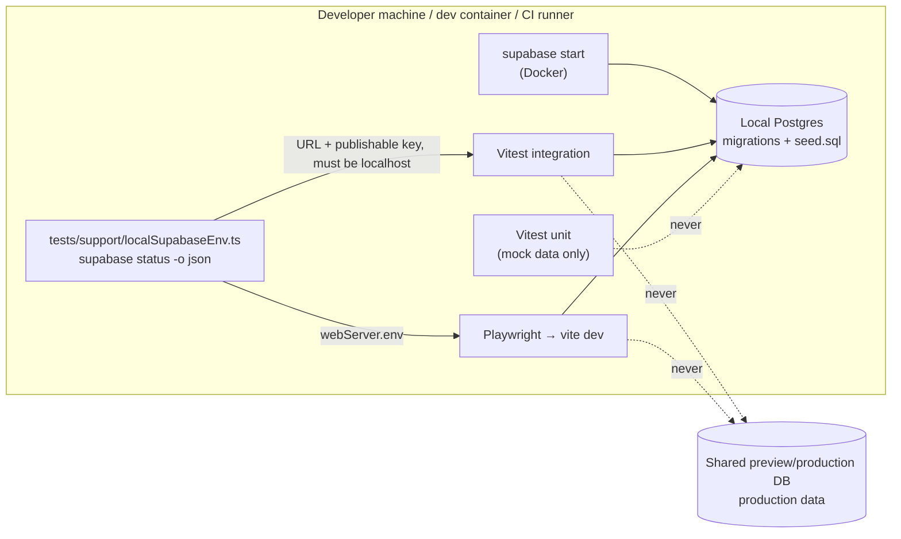

## Context

The `/players` route (`src/routes/players/index.tsx`) renders only a heading. Nothing reads from Supabase yet: `src/client-api/` (renamed to `src/repositories/` in this change) contains only the client and an empty generated `database.types.ts`, `src/domain/players/` is an empty folder, and `supabase/` has no migrations or seed. This change adds the first table, the first read path through the repository seam (ADR 0012), and the first test runs that need a database.

Constraints that shape the design:

- **Layering** (ADR 0012, which supersedes ADR 0003; ADR 0007; `docs/standards/project-structure.md`). `repositories` (formerly `client-api`) query Supabase, map rows to domain types, and validate them with domain schemas. `domain` holds the types, schemas, and rules, knows nothing about storage, and imports nothing else from `src/`. Only `features/players/api/` may import `repositories`. `routes` may import `app`, `features`, `domain`, and `lib`. The `domain` import was allowed in this change, so a route can validate its search params with a domain schema; `routes` still can't import `ui`, `localization`, or `repositories`.
- **Security** (`docs/standards/security.md`). The browser holds the Supabase key, and RLS is the only access boundary. The app uses the publishable key (`sb_publishable_…`), which runs requests as the `anon` Postgres role, the same as the legacy anon key it replaces (D10).
- **Observability** (`docs/standards/observability.md`). The shared `QueryCache.onError` already sends every failed query to Sentry with its query key.
- **Data separation.** **Production data** (84 real **players**) lives only in the shared preview/production database, loaded by hand. **Seed data** (100 fictional **players**) serves local runs and CI. **Mock data** is only for unit tests.
- **UI.** Shadcn (`base-nova` style on Base UI), DESIGN.md tokens, a single `tablet` breakpoint at 744px, no dark mode. The existing six flags in `src/assets/flags/` are vendored artwork (ADR 0006, ADR 0008).
- **E2E.** The tests compare structure, not pixels (ADR 0009). They run the same on macOS, in the dev container, and in CI.

### Containers

- The SPA has no server tier of its own. It reads players straight from PostgREST using the publishable key, so the RLS policy on `players` is the whole security boundary.
- Previews and production share one Supabase project, so the migration and the **production data** script each run once.
- Write access exists only for the product owner's direct database session, never through the API.

## Goals / Non-Goals

**Goals:**

- Put all the **player overview** rules (filter, sort, slice, page range, URL defaults) into pure functions that unit tests can cover exhaustively with **mock data**.
- Keep the URL as the single source of truth for the view, so share, reload, and back/forward work without extra client state.
- Make public read-only access to `players` a database guarantee, not a UI convention.
- Give every test level one clear way to reach data. The same command runs integration and E2E tests against **seed data** on macOS, in the dev container, and in CI, and no path can reach **production data**.

**Non-Goals:**

- Server-side filtering, sorting, or pagination, and virtualization.
- Any write path for **players**, admin UI, or authentication.
- Adopting TanStack Table (recorded in a new ADR, see D4).
- Automating migrations or **production data** loads for preview and production.
- Generalising the table, filters, or pagination into reusable cross-feature components before a second consumer exists.

## Decisions

### Component view

- The route stays thin: it validates search params with the domain schema, imported directly, and renders `PlayerOverview`.
- `PlayerOverview` is the only place where React, i18n, and the domain meet. It reads the URL and the current language, calls `queryPlayers`, and renders the result.
- Every rule in the spec can be tested without React or Supabase, except the visual and interaction rules.

### D1. Schema: one `players` table with constraints that mirror the domain

Migration `supabase/migrations/<timestamp>_create_players.sql`:

- Columns: `id bigint generated always as identity primary key`, `first_name text not null`, `surname text not null`, `surname_prefix text null`, `surname_suffix text null`, `nationality text not null`, `sex player_sex not null`, `created_at timestamptz not null default now()`.
- `player_sex` is a Postgres enum (`'male'`, `'female'`), so the generated types give a string union with no hand-written cast.
- `nationality` has a `check (nationality in ('CZ','DE','HU','PL','NL','GB'))` constraint. Adding a country is then a deliberate change: a migration, a flag asset, and six translations. The domain `Nationality` type mirrors the same list.
- `check` constraints reject empty or whitespace-only names and prefixes or suffixes (`btrim(x) <> ''`), so "no prefix" always means `null`.
- The `id` is an artificial numeric key with no meaning. `generated always` stops scripts from supplying their own ids, so the seed and the **production data** script never collide with the sequence. Rows that reference players later will use this `id`.
- A unique constraint on the natural key `(first_name, surname_prefix, surname, surname_suffix, nationality) nulls not distinct` sits alongside the primary key. It makes the hand-run **production data** script idempotent (`insert … on conflict … do update`), and it stops the same person from being loaded twice.

*Alternatives:* a `uuid` primary key. Rejected in favour of a compact numeric id that is easier to read in the SQL editor and in logs; nothing generates player ids on the client, so uuids bring no benefit here. Using the natural key as the primary key was also rejected: names get corrected (the source list already fixes three spelling mistakes), and a primary key that changes would break future references. `sex` as `text` plus `check`. Rejected because the generated type would be `string` and the mapper would have to narrow it. An open `char(2)` nationality with a format check was also rejected: a row with an unknown country would render with no flag or name, and the mapper would have to choose between dropping it and failing the whole list. An idempotent script that deletes and re-inserts was rejected because it breaks once other tables reference players.

### D2. Access: an RLS select-only policy, with write grants revoked

In the same migration: `enable row level security`, then one policy `for select to anon, authenticated using (true)`. As defence in depth, the migration also runs `revoke all on public.players from anon, authenticated` and then `grant select` to the same roles. Supabase's default grants would otherwise leave RLS as the only layer stopping writes, and starting from nothing means no privilege other than the read survives. An integration test covers the abuse case: with the publishable key (the `anon` role), it inserts, updates, and deletes, expects each to be refused, and checks that the row count and a sample row are unchanged.

*Alternative:* RLS only, keeping the default grants. Rejected because a later mistaken `for all` policy would silently open writes. With the revoke in place, it would still fail.

### D3. Read path: fetch everything once; the repository maps and validates

- `repositories/players/fetchPlayers()` selects the explicit columns `id, first_name, surname, surname_prefix, surname_suffix, nationality, sex`, throws the Supabase error if there is one, and returns `Player[]`. It orders the rows only by `id`, so every refetch returns the same sequence; the display order depends on the language and happens in the domain.
- `repositories/players/toPlayer(row)` takes the generated row type, renames the columns to `Player` fields (`{ id, firstName, surname, surnamePrefix?, surnameSuffix?, nationality, sex }`, a `null` prefix or suffix becomes an absent key), and validates the result with the domain's `playerSchema`. A renamed column fails typechecking at the query; a value the generated types can't narrow (`nationality` is `text`) fails at parse time. The error goes up to the query, so a schema drift shows up as the error state and is reported, never as a silently partial list.
- `domain/players/playerSchema` is the only player schema, and `Player` is inferred from it. The domain knows no column names.
- `features/players/api/usePlayers()` is `useQuery({ queryKey: ['players'], queryFn: () => fetchPlayers() })`. The query key names the table, which meets the correlation rule in the observability standard through the existing `QueryCache.onError`. No component-level reporting is added.

*Alternatives:* the mapper in `domain` with a hand-declared row shape (the original plan). Rejected on 2026-10-20: it put database column names in the domain and duplicated the generated row type. The mapper in `features/players/api`. Rejected because features can't import each other, so another feature (for example tournaments) couldn't reuse it. Server-side range queries with `order` and `range`. Rejected for now (out of scope). The data is 84 rows, and Postgres collation can't easily follow the active UI language. Revisit if the number of **players** reaches the thousands, or PostgREST's `max_rows` (1000) becomes a risk.

### D4. One pure domain query function for filter → sort → slice

`domain/players/queryPlayers(players, view, locale)` returns `{ rows, total, page, pageCount }`, where `view = { nationality, sex, sort, page, pageSize }`:

1. Filter with AND. A value of `'all'` lets everything through.
2. Sort with a comparator built from `new Intl.Collator(locale, { sensitivity: 'accent' })`. The keys are `surname` (prefix ignored), then `firstName`, then the suffix rank: no suffix first, then the suffixes in collator order, so `jr.` comes before `sr.`. `'desc'` negates the whole comparator, so every key reverses, as the spec scenarios require. Sensitivity `accent` makes the comparison case-insensitive and keeps diacritics meaningful, and the `cs` collation puts "Ch" after "H".
3. Slice. `pageCount = max(1, ceil(total / pageSize))`. If `page > pageCount`, the effective `page` is 1. The returned `page` is the effective one.

Two companion helpers live with it: `formatSurname(player)` builds `[prefix] surname [suffix]`, and `presentNationalities(players)` returns the distinct nationalities for the filter options. The component sorts those options by localized country name, using the same collator.

The component calls `queryPlayers` inside `useMemo`, keyed on the players, the validated search, and `i18n.language`, so switching language re-sorts at once.

*Alternatives:* TanStack Table's sorting, filtering, and pagination models. Rejected: one sortable column and two filters don't justify a headless table engine, and the sort comparator with three keys and locale-aware rules would have to be written by hand anyway. ADR 0002 no longer prescribes a table library (its TanStack Table line was removed on 2026-10-19), so a new standalone ADR records this choice and the triggers for revisiting it: several sortable columns, multi-column sorting, column visibility, row selection, or several complex tables. Splitting the logic into three separately composed functions was also rejected, because one entry point keeps the order (filter, then sort, then slice) and the page fallback in one tested place.

### D5. Page link range is a generic `lib` helper

`lib/pageRange(current, count)` returns `(number | 'ellipsis')[]`. It always includes 1, `count`, and `current ± 1`. A gap of exactly one page is filled with that page number, and a gap of two or more becomes `'ellipsis'`. It has no business meaning, so it belongs in `lib`, not `domain/players`, and a future tournament list can reuse it. Unit tests check every spec example (`1 2 … 10`, `1 … 9 10`, `1 … 4 5 6 … 10`, `1 2 3 4`).

### D6. URL is the only view state; validation by Zod and `.catch()`

- `domain/players/playerOverviewSearchSchema` (Zod 4, used directly as a Standard Schema validator by TanStack Router) defines `sort: 'asc' | 'desc'`, `nationality: Nationality | 'all'`, `sex: Sex | 'all'`, `page: positive int`, and `pageSize: 10 | 25 | 50`. Each field has `.catch(default)`, so `pageSize=7`, `page=abc`, an unknown code, sex, or sort direction each fall back on their own, without throwing or touching the other params.
- The route uses `validateSearch` with that schema and `search.middlewares: [stripSearchParams(defaults)]`, so default values never show in the URL. Choosing "All" again therefore leaves a clean `/players`.
- Param names and values: `sort=desc`, `nationality=CZ`, `sex=female`, `page=2`, `pageSize=10`.
- Every view change (a filter, sort, page size, or Clear filters) is one `navigate({ search })` call that also drops `page`, so the page always returns to 1. A page change is `navigate({ search: { …, page } })`. Each one adds a history entry, so back and forward walk through views.
- A `page` beyond the last page renders page 1 (D4). The component then replaces the URL (`replace: true`, dropping `page`), so the address bar matches what is shown without adding a history entry. This happens only after the data has loaded, because the last page isn't known before that.

*Alternatives:* filters in a Zustand store. Rejected because ADR 0002 puts shareable screen state in search params. Throwing on invalid params and showing an error was rejected because the spec asks for silent fallback.

### D7. UI composition: Shadcn primitives, CSS-only responsiveness

- Add the Shadcn `table`, `tooltip`, and `pagination` primitives to `src/ui/`, and reuse the existing `select`.
- **Table.** It has a `<caption>` (visually hidden, `tabIndex={-1}`, the focus target) and three columns. Cells wrap text, and the Nationality column has a fixed narrow width, so the table fits 320px with no horizontal page scroll.
- **Sort header.** A `<button>` inside the Surname `<th>`, which carries `aria-sort`. A lucide arrow icon shows the direction.
- **Flags.** The flag map in `LanguageOption.tsx` moves to `src/localization/flags.ts`, and a shared `Flag` image component sits next to it. The language selector and the player feature both use them (`features → localization` is allowed). In the table, each flag is a tooltip trigger with `role="img"`, an `aria-label` set to the localized country name, and `tabIndex={0}`, so the tooltip opens on focus as well as on hover.
- **Country names and sex labels.** These are i18n keys (`countries.CZ`, `players.sex.female`, and so on) in all six locale files, as the proposal requires, not `Intl.DisplayNames`. The translations stay reviewed and identical across browsers.
- **Responsiveness.** The filters use `flex-col tablet:flex-row`. Pagination renders both variants and switches them with `tablet:` utilities (`hidden tablet:flex` and the inverse). Hidden markup is `display: none`, so it stays out of the accessibility tree, and E2E tests can check visibility at 375px and 1280px without `matchMedia` logic in JS.
- **Page links.** They are TanStack Router `<Link>`s with typed search, so they are real `href`s that work with a middle-click. Previous on page 1 and Next on the last page render as non-interactive elements with `aria-disabled="true"`, because a link can't be disabled.
- **Orientation after a page change.** An effect keyed on `page` (skipped on first render) scrolls the table into view and focuses the caption. A visually hidden `aria-live="polite"` region gets the new summary only on page changes, so filter changes and the first load don't announce twice.
- **States.** `isPending` shows a skeleton in place of the table. `isError` shows a message and a Retry button that calls `refetch()`. An empty list shows "No players yet" with no filters or pagination. A filtered result with no rows shows "No players match the selected filters" and Clear filters, which resets the nationality, sex, and page and keeps the sort and page size.

*Alternatives:* switching the layout in JS with `matchMedia`. Rejected because it makes rendering depend on the viewport and doubles the test setups. Card rows on phones were rejected, since the spec keeps the table at every width.

### D8. Test data topology: one local Supabase path for all environments

- `tests/support/localSupabaseEnv.ts` runs `supabase status -o json`. It returns `VITE_SUPABASE_URL` and `VITE_SUPABASE_PUBLISHABLE_KEY` from the CLI's `API_URL` and `PUBLISHABLE_KEY` fields. It fails fast with a clear message when Supabase isn't running, and it refuses any URL whose host isn't `127.0.0.1` or `localhost`.
- The new testing standard (`docs/standards/testing.md`) makes this guard a rule: every test that reaches a database gets its connection from this helper and runs against a localhost Supabase only. Hand-written connection settings in tests are not allowed.
- `vitest.integration.config.ts` passes those values through `test.env`. `playwright.config.ts` passes them through `webServer.env`, and Vite gives `process.env` precedence over `.env*` files. A developer's `.env.local` pointing at the shared project can therefore never leak into a test run.
- CI adds one step before the integration tests: `npx supabase start -x studio,imgproxy,storage-api,edge-runtime,logflare,vector,mailpit,realtime`. The excluded services aren't needed, which cuts start-up time. The tests read the env through the same helper, so no secrets or `$GITHUB_ENV` plumbing are needed.
- `supabase db reset` reapplies migrations and `seed.sql`. Integration and E2E tests only read players (RLS forbids anything else), so the shared seed is never mutated and the tests can stay `fullyParallel`.
- E2E tests intercept `**/rest/v1/players*` only for "No players yet" (`[]`) and the error scenarios (HTTP 500, then pass-through for Retry).
- Unit tests for `toPlayer`, `queryPlayers`, `pageRange`, the search schema, and component states use **mock data**: domain builders in `src/domain/players/playerMocks.ts` and row builders in `src/repositories/players/playerRowMocks.ts`. Component tests mock `fetchPlayers`. Components get a fresh `QueryClient` with `retry: false`.

*Alternatives:* committing a `.env.test` with the local publishable key the CLI prints. Rejected because that key is a CLI default that can change between CLI versions, a stale key fails confusingly, and a static file can't check that Supabase is running or that the URL is local. A hosted test project was rejected because it adds a shared mutable dependency and secrets in CI.

### D9. Seed and production data files

- `supabase/seed.sql` is committed. It holds 100 fictional `insert`s that meet the counts in the spec (40 female, 24 CZ, 4 HU, 0 female GB), plus the edge cases listed in the proposal. A `seed.integration.test.ts` checks these counts against the local database, so a later edit to the seed can't silently break the E2E expectations.
- The **production data** script (`supabase/data/…sql`, gitignored and already covered by `supabase/.gitignore`) uses `insert … on conflict (natural key) do update set sex = excluded.sex` inside one transaction, so re-running it is safe.
- `src/repositories/database.types.ts` is regenerated with `supabase gen types typescript --local`, exposed as a `supabase:types` npm script.

### D10. The app uses the publishable key instead of the legacy anon key

- Read the key from `VITE_SUPABASE_PUBLISHABLE_KEY` in `src/repositories/supabaseClient.ts`, `src/vite-env.d.ts`, and `.env.example`. `createClient(url, publishableKey)` is unchanged otherwise, because supabase-js accepts both kinds of key in the same parameter.
- The publishable key runs requests as the `anon` role, so the RLS policy (`to anon, authenticated`) and the revoked grants (D2) apply unchanged.
- Local and CI runs use the CLI's `PUBLISHABLE_KEY` (D8). The installed Supabase CLI (v2.119) already reports it in `supabase status -o json`.
- Update the wording in `docs/standards/security.md` and `docs/standards/observability.md` from "anon key" to "publishable key", and list the required Vercel variables in `docs/guides/deployment.md`.

*Alternative:* keep the legacy JWT anon key. Rejected: Supabase is phasing out the JWT-based keys. Publishable keys can be rotated on their own without rotating the JWT secret, and the switch is cheapest now, while only one client file reads the key.

## Risks / Trade-offs

- [Every flag is a tab stop, about 25 per page by default, so keyboard users tab through many flags] → The spec requires the tooltip on focus. Keep the flags in natural order after the name cells, and revisit if accessibility feedback flags it.
- [TanStack Query's default 3 retries with backoff delay the error state by about 7 s] → Keep the defaults for production resilience. The E2E error scenario intercepts every request and uses a longer assertion timeout. Unit tests disable retries.
- [The client fetches all rows; PostgREST caps responses at `max_rows` = 1000] → 84 rows today, and server-side paging is a recorded follow-up. `fetchPlayers` throws once a response reaches 1000 rows, so a cut-off list shows the error state instead of a silently partial one (unit-tested). Revisit at a few hundred **players**.
- [`Intl.Collator` output for `cs` and `hu` can differ slightly between browser engines] → The E2E tests run only Chromium. The spec examples (Ch after H, case-insensitive order) are stable across ICU versions.
- [The natural unique key could reject two real people with the same full name and nationality] → No such case exists in the source list. If it happens, add a disambiguating column in a new migration.
- [Integration and E2E tests now need Docker and `supabase start` locally, and CI takes about 1–3 minutes longer] → The fast-failing helper gives a clear message, the E2E guide documents the setup per environment, and unused services are excluded in CI.
- [Allowing `routes → domain` could tempt routes to hold business logic] → Routes may import domain schemas and types for validation only. The project-structure standard states this, and the rules themselves stay in `domain`.
- [The app fails at start-up if `VITE_SUPABASE_PUBLISHABLE_KEY` is missing in Vercel] → The migration plan sets the variable for preview and production before the merge. `supabaseClient.ts` keeps its fail-fast error, renamed to the new variable.

## Migration Plan

1. Before merge, the product owner copies the publishable key from the Supabase dashboard (API keys) into Vercel as `VITE_SUPABASE_PUBLISHABLE_KEY` for preview and production.
2. Before merge, the product owner applies the migration to the shared Supabase project (`supabase db push` or the SQL editor). It only adds a table, an enum, and a policy, so the deployed app is unaffected.
3. The product owner runs the **production data** script once, then checks that 84 rows exist and that an anonymous `select` works.
4. Merge. Vercel deploys the new `/players` page, and previews and production both read the populated table.
5. **Rollback:** revert the UI commit and redeploy. The table can stay, since it is harmless and read-only. If it has to go, `drop table public.players; drop type player_sex;` by hand, then re-run the script after re-applying.

## Open Questions

None. Resolved on 2026-10-19:

- ADR 0002's TanStack Table line was removed in place (with a dated note), so the new table-library ADR stands alone and supersedes nothing.
- `routes → domain` is now allowed: `docs/standards/project-structure.md` and `eslint.config.mjs` were updated.
- The localhost guard is a rule of the new testing standard (D8).
- The app switches to the publishable key (D10).
