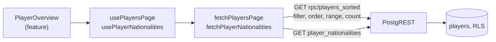

## Context

`usePlayers` fetches every **player** once and `queryPlayers` (ADR 0010) filters, sorts and slices them in the browser. The product owner wants paging and filtering in the backend as a general rule, and a page size the **visitor** can't change. Three things that today rely on the browser holding every row have to move as well:

- **The sort order.** A page can only be cut from an order the backend knows. The spec requires the order of the current UI language, ignoring case.
- **The nationality filter's options**, which offer only **nationalities** some **player** has.
- **"No players yet" versus "No players match"**, which told the two apart by looking at the full list.

The SPA has no server of its own (ADR 0001), so "the backend" means PostgREST and Postgres, reached through the `data-access/api` seam (ADR 0017).

## Goals / Non-Goals

**Goals:**

- The browser receives one page of **players** plus the filtered total, never the whole list.
- No visible change to the sort order, the filters, the page links, or the URL behaviour, apart from the removed selector.
- Page changes don't flash a skeleton.

**Non-Goals:**

- Indexes for the sort. There are 84 real **players**, and a sort of that size costs nothing. Revisit if the table grows into the tens of thousands.
- Enforcing the page size in the backend. Player data is public and PostgREST already caps a response at 1000 rows, so a tampered request only changes what that **visitor** sees (ADR 0018).

## Decisions

### D1: Sort with one ICU collation per UI language

`create collation ... (provider = icu, locale = '<language>-u-ks-level2', deterministic = false)`. Level 2 matches `Intl.Collator(locale, { sensitivity: 'accent' })`, which the client used. Non-deterministic makes case-only differences true ties, so the next sort key decides. Both orderings were compared against `Intl.Collator` on names with Czech "Ch", diacritics and case differences, and were identical.

Alternatives: a plain `surname` order in the database's default collation, rejected because it breaks the Czech scenario and the case scenario. Dropping language-aware sorting, rejected because it changes specified behaviour.

### D2: `players_sorted(ui_language)` returns every player with a `sort_position`; PostgREST does the rest

The function computes `row_number()` over the three sort keys plus `id`. The client filters with `.eq()`, pages with `.range()`, counts with `count: 'exact'`, and orders by `sort_position` ascending or descending. Reversing the position reverses every key, as the spec requires.

- The `id` makes the order total, so a **player** can't move between pages from one request to the next.
- It returns a named composite type, because PostgREST can't filter or order the anonymous record of `returns table`.
- PostgREST narrows a function call to the selected columns, so the query must select `sort_position` to order by it.

Alternatives:

- A function taking filters, sort direction, limit and offset. Rejected: it re-implements what PostgREST already does, and needs its own way of returning the total.
- A view with three collated columns per language (18 columns). Rejected: it leaks a column per language into the client's order clause, and adding a language changes the query.
- Ordering inside the function and relying on the outer query to keep it. Rejected: SQL doesn't guarantee it, and a page boundary depends on it.

### D3: The filter options come from a `player_nationalities` view

`select distinct nationality` with `security_invoker = true`, so RLS on `players` still applies. It has its own query and cache entry, so the options don't depend on the current filter. Sorting the options by localized country name stays in the client, because only the client has the translations.

### D4: "No players yet" means the nationalities view is empty

Every **player** has a **nationality** (`not null`), so an empty view means no **players** exist, whatever the filters say. `total === 0` with any **nationality** present means no match. This keeps the old rule exactly, including for a filtered URL on an empty table, and needs no extra count request.

### D5: A page beyond the last falls back in `fetchPlayersPage`

PostgREST answers an offset beyond the total with `416 PGRST103`, and an offset equal to the total with an empty `206`. Either way `fetchPlayersPage` requests page 1 and returns it with `page: 1`, which `useCanonicalPage` then writes to the URL. The result keeps the `{ rows, total, page, pageCount }` shape the UI already used. This costs extra requests only on the rare out-of-range URL.

### D6: Keep the previous page on screen while the next loads

The hook uses `placeholderData: keepPreviousData`, so no skeleton flashes. `search` then changes before the rows do, so `useCanonicalPage` and `usePageChangeOrientation` must not act on placeholder data. The first would write the old page back to the URL. The second would see a filter change followed by a "page change", and announce it. Both wait until the rows for the current view have arrived.

### D7: Query keys name the RPC and the view

`['players_sorted', language, view]` and `['player_nationalities']`, as the observability standard requires.

### D8: The page size is one constant for the whole app

`itemsPerPage = 25` in `src/config/pagination.ts`. Every list in the app uses the same page size, so it is an app setting with no owning **module**, rather than code that starts in one (ADR 0016). `domain/` can't import `config`, and doesn't need to: only the `data-access/api` query and the **feature**'s summary use the value.

## Risks / Trade-offs

- [Sorting differs slightly between ICU versions] -> Only Postgres sorts now, so the order is at least the same for every **visitor**. A spec scenario covers each rule against real data.
- [Every request is a round trip, where filtering used to be instant] -> A 5-minute `staleTime` serves revisited views from the cache, and `keepPreviousData` holds the old rows on screen.
- [Each page request sorts every player] -> Negligible at this size. See Non-Goals.
- [A hosted project without ICU support] -> The local Supabase image has it, and Preview gets the migration first, per the deployment guide.

## Migration Plan

Apply the migration to Preview, check the Preview deployment, apply it to Production just before merging, then merge (`docs/guides/deployment-guide.md`). The migration only adds objects, so the old frontend keeps working in between. To roll back, revert the Vercel deploy and leave the objects in place.

## Open Questions

_None._ ADR 0010 no longer holds, so the adr step supersedes it.
