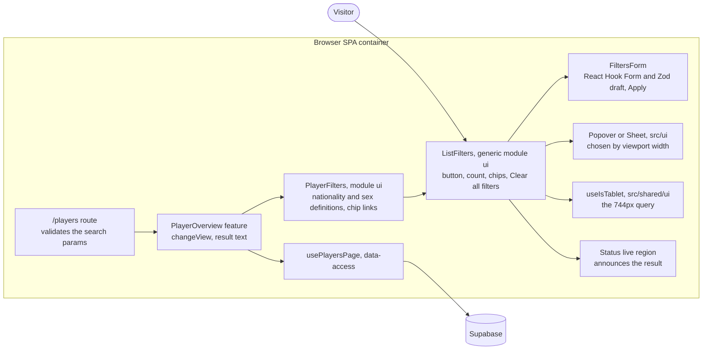

## Context

The **player overview** shows its two **filters** as always-visible `FilterSelect`s that apply the moment an option is picked (`src/modules/players/ui/PlayerFilters.tsx`, wired in `features/player-overview/PlayerOverview.tsx`). The proposal replaces them with a **filters button** and a **filters panel**, and the delta spec fixes the behaviour. This design says how to build it so the next list can reuse it.

Constraints from the ADRs in force:

- **ADR 0002:** the view is URL state in route search params, and forms use React Hook Form with Zod. No form uses React Hook Form yet, so this is its first use.
- **ADR 0015:** Shadcn components are built on Base UI. `src/ui/` already has Select and Sheet.
- **ADR 0016 and the structure standard:** code starts in its **module**. It moves to **shared code** only when a second **module** or `app` needs it. A **feature** is the only layer that reaches `data-access/`.
- **ADR 0020:** filtering stays in the backend, and the URL params are unchanged.
- **ADR 0005:** every string is a translation key in all six languages.
- **ADR 0009:** e2e tests assert structure, never pixels.

Two facts shape the design. `PlayerPagination` already renders router `Link`s from `ui/`, so a `ui/` component may use the router. And `TopNav` already has a private copy of the 744px media query and closes its menu when the viewport crosses it, which is the same need the **filters panel** has.

## Goals / Non-Goals

**Goals:**

- Build the pattern as a generic, props-driven component in the players **module**, so moving it to **shared code** later is a file move.
- Meet every requirement in the `players/player-overview` delta spec, including the focus and announcement rules.
- Keep the URL params, the backend queries and the page-change orientation hook as they are.

**Non-Goals:**

- Moving the component to `src/shared/ui/` now (ADR 0016 stays as it is).
- Filter types other than single-select, and server rendering or a no-JavaScript guarantee.
- Changing `TopNav` behaviour. It only reuses the shared media query helper.

## Decisions

### 1. A generic `list-filters` component, with the players part on top

- **`ui/list-filters/` (generic).** `ListFilters` owns the button, the count, the chip row, Clear all filters, the choice of overlay, and the live region. `FiltersForm` owns the **filter draft**. `AppliedFilterChips` and `FilterField` (the current `FilterSelect`, labelled and rendered through Base UI Select) are its parts. It knows nothing about players, the router or Supabase.
- **`ui/PlayerFilters.tsx` (players).** It declares the nationality and sex **filters** (labels, options with flags, the chip label) and supplies the chip links. It replaces `NationalityFilter`, `SexFilter` and `FilterSelect`.
- **`features/player-overview/`.** `PlayerOverview.tsx` keeps `changeView`, which already returns to page 1 in one navigation, and passes the applied values, `changeView`, the result text and `isShowingPreviousPage` down.
- **`domain/types/playerOverviewSearch.ts`.** Adds `playerFiltersSchema`, the nationality and sex fields picked from the search schema. It is the form's schema and the one place that decides what a valid **filter draft** is.

*Alternative:* keep it all in `PlayerFilters.tsx`. Rejected: a second list would copy it, and the standard needs something concrete to point to.

### 2. Filters are declared, not hand-rendered

`ListFilters` takes `filters`, a list of `{ name, label, options }` where each option has a `value`, a `label` (a node, so nationality can show a flag) and a `chipLabel`, plus `values`, `onApply(values)` and a `chipLink` render prop. A new list declares its filters and gets the button, form, chips, Clear all filters, focus handling and announcement for free. Only single-select exists, as the proposal says.

*Alternative:* children-based composition, where the caller lays out the fields. Rejected: every caller would have to rewire the draft, the chips and the count, which is where the accessibility rules live.

### 3. Popover on wide screens, bottom Sheet on narrow ones, switched by viewport width

`useIsTablet()` picks the overlay. The overlay is rendered with `key={isTablet ? 'popover' : 'sheet'}` and holds its own open state, so crossing 744px remounts it closed and drops the **filter draft** without an effect. The popover is Base UI's Popover, added to `src/ui/popover.tsx` through shadcn (ADR 0015). The sheet is the existing `Sheet` with `side="bottom"`, `max-h-svh` and `overflow-y-auto`, so it needs no arbitrary values and avoids the width bug in #92. Base UI returns focus to the trigger when either closes, which covers Apply and Escape. The popover is non-modal, and the sheet traps focus.

The panel holds only single-selects, which never open the on-screen keyboard, so the keyboard is not a layout concern here. `index.html` sets no `viewport-fit=cover`, so phone browsers already keep fixed content clear of the home indicator and the sheet needs no `env(safe-area-inset-bottom)` padding, which the design-system standard would reject as an arbitrary value. If `viewport-fit=cover` is ever added, the sheet needs revisiting.

*Alternative:* the prototype's `
` with hand-written outside-click, Escape and positioning. Rejected: with no baseline mode to protect (Q1 of the interview), it only costs code and special cases.

### 4. The 744px query becomes shared code

`src/shared/ui/` gets `tabletMediaQuery()` and `useIsTablet()` (a `useSyncExternalStore` over `matchMedia`). `app` (`TopNav`) and the players **module** both need it, which meets ADR 0016's rule for **shared code**. `TopNav` imports `tabletMediaQuery()` in place of its private copy, and keeps its own close-on-change listener. The query still reads the `--breakpoint-tablet` token, so the menu and the **filters panel** change at the same width.

### 5. The filter draft is a React Hook Form form validated by Zod

`FiltersForm` uses `useForm` with `zodResolver(playerFiltersSchema)`-style schemas supplied by the caller, and a `Controller` around each Base UI Select. The form is a real `<form method="get" action>` whose control names equal the search param names, so the markup stays truthful. `onSubmit={handleSubmit(onApply)}` prevents the browser's own submit. ADR 0002 asks for React Hook Form, and the draft is exactly "form state before submit".

*Alternative:* `useState`, as in the prototype. Simpler, but it would be the first form in the app that ignores ADR 0002, and the standard would have to explain why.

### 6. Chips and Clear all filters are router links

The chips and Clear all filters are links with real `href`s, so they work in a new tab and need no click handler. `PlayerFilters` builds them with `Link from="/players/" to="." search={(prev) => ({ ...prev, ...change, page: undefined })}`, the pattern `PlayerPagination` already uses. This keeps the sort direction and drops the page, and the route's `stripSearchParams` keeps defaults out of the URL. `ListFilters` stays router-free by receiving `chipLink` as a prop. Clear all filters is a link styled as a button, because it navigates.

### 7. Focus and announcement

- **Apply, Escape, Close:** handled by the overlay's own focus return.
- **Chip removal and Clear all filters:** the chip or link disappears, so `ListFilters` focuses the **filters button** through a ref in the click handler. The router navigation then runs as usual.
- **Announcement:** `useFilterAnnouncement(resultText, isShowingPreviousPage)` lives in `ui/list-filters/`. A user action marks a result as pending. The hook says it once the rows of the new view are on screen, which is when `isShowingPreviousPage` is false, because the search changes before the rows do. If the action changed nothing, it announces the current result at once. The text is the summary, or the no-match message when the total is zero, and comes from the feature.
- It uses its own `role="status"` region. The existing page-change region and `usePageChangeOrientation` stay untouched, and a URL change that is not a user action, such as Back, still announces nothing, as the existing test requires.

### 8. Strings live under `listFilters.*`

The generic strings (the button, Apply, Clear all filters, the "Applied filters" label, "Remove filter: {{name}}", the panel title and description) go under a new top-level `listFilters` key in all six locale files, so moving the component to **shared code** needs no key renames. The nationality and sex labels stay under `players.filters`.

### 9. Tests

- **Unit:** the draft, Apply, discard on close, chips, Clear all filters and the announcement logic, with a `matchMedia` stub since jsdom has none. `PlayerOverview.unit.test.tsx` loses the two "Clear filters" tests and gains the new equivalents. Its "does not treat a filter change as a page change" test stays valid.
- **e2e:** `chooseFilter` in `tests/e2e/players/overview.ts` opens the **filters panel**, picks the option, and activates Apply, so the specs that use it keep their shape. The specs that click "Clear filters" (`sex-filter`, `pagination`) use Clear all filters. New specs run at 1000px and 375px: popover versus sheet, the keyboard flow, the announcement, chip removal, and the viewport crossing 744px.
- **Manual gate:** the real-device check from the proposal.

## Risks / Trade-offs

- [Base UI's Popover and Select are nested overlays, and the select's list lives outside the popover] → Check outside-press and Escape handling first. If it misbehaves, guard the popover's outside press as the prototype did for the select list.
- [First use of React Hook Form, with Zod 4] → `@hookform/resolvers` ^5 supports Zod 4. A short note in the standard shows the pattern for the next list.
- [The sheet inside a phone browser: where the select's own list opens when its trigger sits near the bottom edge, and how the sheet follows the browser toolbars] → The real-device gate. If it fails on a phone, fall back to native pickers on mobile only.
- [Chips appearing on a phone add one line, so the table moves once after the first Apply] → Accepted. Opening and closing the panel never moves the table, which is what the spec requires.
- [Two live regions] → They never speak for the same event, because the page-change one reacts to a changed page and the new one to a user action on a filter.
- [Changing the e2e helper touches many specs] → The helper keeps its signature, so the specs change only where the Clear action or the layout assumptions were hard-coded.
- [The standard is written before a second list exists] → The generic API is shaped by one list. The standard says to revisit it when the second list arrives.

## Migration Plan

No data, API or URL migration: old links with `nationality` and `sex` params keep working. The change ships as one PR in slices: the shared media query and the Popover primitive, then the generic component with its unit tests, then the players wiring with the updated e2e specs, then the ADR, the standard and the translations. Rollback is reverting the PR, because nothing else depends on it.

## Open Questions

- None block the implementation. One generic "Filters" title is used for every list, and an optional `title` prop can be added when a list needs its own. `TopNav` keeps its own change listener and only shares the media query string.
- The real-device check settles where the select's list opens near the sheet's bottom edge, before the sheet's CSS is final.
- No in-force ADR needs revisiting. ADR 0016 is followed as it is, with the media query helper as the first piece of **shared code** this change adds.
