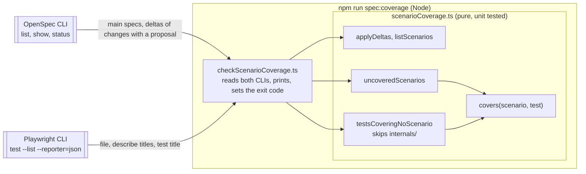

## Context

`npm run spec:coverage` (`tests/support/checkScenarioCoverage.ts`) checks one direction today: every scenario in force has an E2E test titled with the scenario name, in a `test.describe` titled with the requirement name. The matching is a pure function, `uncoveredScenarios` in `tests/support/scenarioCoverage.ts`, with unit tests beside it. The CLI wrapper feeds it from `openspec list`/`show` and `playwright test --list --reporter=json`, so the check needs neither Supabase nor a browser.

The proposal adds the other direction, with one exempt folder for **internals tests**. The delta specs add 6 scenarios for behaviour that existing tests already check.

Two facts found while planning:

- The wrapper calls `openspec show <change> --deltas-only` for every active change. For a change that has no `proposal.md` yet, that command exits non-zero, and the check crashes. Creating this change hit it.
- In Playwright's JSON report, each top-level suite is a spec file, titled with its path relative to `testDir` (`tests/e2e`), such as `players/listing.spec.ts`. The wrapper drops that title today.

ADRs in force that touch this change:

- **ADR 0009:** E2E tests assert structure, sizes, and positions, never pixels. The `Sheet` width tests measure an element's width, which this allows, and they keep doing so in `internals/`.
- **ADR 0011:** E2E tests read only the local **seed data**, and intercept requests only for states the seed can't produce. The long-name test keeps its interception.
- **ADR 0014:** client errors and logs go to Sentry. `fixtures.spec.ts` tests the fixture that fails a test on a Sentry report. It moves without changes.

No ADR in force needs revisiting.

## Goals / Non-Goals

**Goals:**

- One run of `npm run spec:coverage` reports both directions and fails if either is non-empty.
- The matching rule is defined once and shared by both directions, so a test that covers a scenario in one direction is never reported as covering none in the other.
- The **internals test** exemption lives in the pure core, so unit tests cover it.
- An active change with no `proposal.md` contributes no delta specs instead of crashing the check.

**Non-Goals:**

- Checking that an **internals test** starts with its comment or links a bug. Review enforces it.
- Tracing unit and integration tests.
- Any app code change.

## Decisions

### 1. One matching predicate, two directions

- The predicate inside `uncoveredScenarios` becomes an exported `covers(scenario, test)`: the innermost describe is the requirement name, and the title is the scenario name, or `<scenario name>: <example>` for a scenario with an Examples table.
- A new `testsCoveringNoScenario(scenarios, tests)` returns every test outside `internals/` that `covers` no scenario.
- A test becomes `{ file, titlePath }`, not just a title path, so the report can name the file and the exemption can use it. `uncoveredScenarios` takes the same shape.
- *Alternative:* a second, separate matcher for the reverse direction. Rejected, because two matchers can drift apart, and a test could then count in one direction but not the other.

### 2. The exemption is the folder, as a path prefix in the core

- `testsCoveringNoScenario` skips a test whose `file` starts with `internals/`. The prefix is one exported constant, and the testing standard names the same folder.
- *Alternative:* a Playwright tag such as `@internals`. Rejected: a tag can go on any test anywhere, and in review it's easier to miss than a file in a folder whose name says what it holds.
- *Alternative:* a separate Playwright project for internals tests. Rejected: it changes how the suite runs just to express an exemption.

### 3. The report lists both directions, then fails

- The wrapper prints the uncovered scenarios as `spec › requirement › scenario`, as it does today. It then prints the tests that cover no scenario as `file › describe › … › title`, under a heading that points to the testing standard and to `tests/e2e/internals/`.
- It exits 1 if either list is non-empty. On success it prints both counts, such as "All <n> spec scenarios have an E2E test, and all <m> E2E tests outside internals/ cover a scenario."

### 4. Skip a change whose proposal isn't done yet

- Before `openspec show`, the wrapper runs `openspec status --change <name> --json`. If the `proposal` artifact isn't `done`, the change contributes no deltas.
- *Alternative:* catch the failure of `openspec show`. Rejected: it would also hide a broken delta spec, which should fail loudly.
- *Alternative:* look for `proposal.md` on disk. Rejected: the CLI knows where a change lives, and the wrapper already gets everything else through the CLI.

### 5. Test moves, merges, and renames

| Today | After |
| --- | --- |
| `tests/e2e/fixtures.spec.ts` | `tests/e2e/internals/fixtures.spec.ts`, with its import changed to `../fixtures` and a top-of-file comment |
| `navigation.spec.ts` › Sheet width at the sm breakpoint and wider (3 tests) | `tests/e2e/internals/sheet.spec.ts`, with a comment linking #92. `openAt`, `openMenu`, `menu`, and `boxOf` come from the existing helpers |
| Phone repeats of 4 scenarios | Merged into each scenario's existing test, which checks the phone case as well |
| `routes.spec.ts`, and "Close is named in the UI language" | Deleted (duplicates) |
| 6 tests behind the new scenarios | Retitled to the scenario names, in describes titled with their requirement names. The no-scroll test becomes 4 tests, one per Examples row. The menu test widens to 744px, not 1280px. The no-announcement test also checks that the filter result is announced once |

- Updated with the move: the path in `docs/guides/testing-guide.md` (Sentry buffered-log note), and the `tests/e2e/` line of the tree in `docs/standards/project-structure-standard.md`, which now names `internals/`.
- The ESLint rules for `tests/e2e/**` already match `internals/`, so `fixtures.spec.ts` keeps importing `test` from the fixture, not from `@playwright/test`.

## Risks / Trade-offs

- [`internals/` becomes a place for tests nobody wants to write a scenario for] → The testing standard limits it to tests of how the app or its test setup is built, and each file says why it has no scenario. Review rejects anything else.
- [A future change removes a requirement and forgets its tests] → The reverse check fails on the orphaned tests, which is the intent. The failure message names the file, so the fix is quick.
- [Merging phone repeats makes those tests longer] → Each merged test still checks one scenario. If a merged test gets hard to read, an Examples table is the agreed way to split it.
- [`openspec status` adds one CLI call per active change] → There are only a few active changes at a time, and the check already makes one `show` call each.

## Migration Plan

Not applicable. There is no deploy or data change. Rolling back means reverting the commit.

## Open Questions

None.
